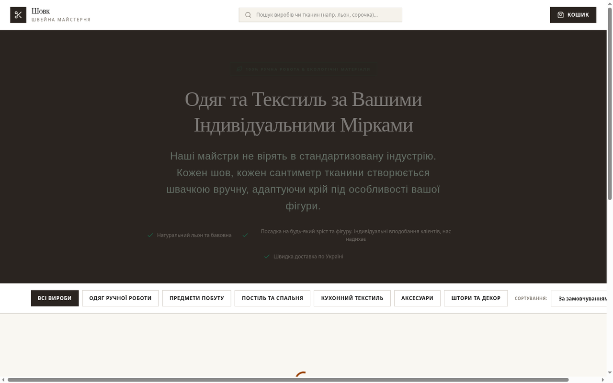

# Yulia (Nytka) — Bespoke Tailoring Platform

A full-stack web application for bespoke, made-to-measure tailoring. Customers can browse products, choose standard sizes or enter custom measurements, and place orders. The admin panel manages products, orders, analytics and shop settings.



## Features

### Storefront
- Product catalog with category filtering and sorting.
- Custom measurement engine.
- Checkout with shipping and payment options.
- Responsive editorial UI.

### Admin panel
- Sales and order analytics.
- Order workflow management.
- Product and inventory management.
- Shop settings and payment toggles.

## Tech stack

- React 18
- Vite
- TypeScript
- Tailwind CSS
- Node.js / Express
- Firebase Firestore

## Quick start

```bash
npm install
npm run dev
```

Open `http://localhost:3000`.

Production build:

```bash
npm run build
npm run start
```

## Configuration

Firebase is optional. Configure it through environment variables or a local `firebase-applet-config.json` created from `firebase-applet-config.example.json`. Do not commit real Firebase configuration or service-account files.

## Security notes

- Admin and Firebase configuration should stay in local, git-ignored files.
- Change default admin credentials before deployment.
- Use Firebase security rules for production data.

## License

This project is licensed under the [MIT License](LICENSE).

## Українською (коротко)

Yulia («Нитка») — full-stack платформа для індивідуального пошиву: каталог, конструктор мірок, оформлення замовлень і адмін-панель з аналітикою, керуванням товарами та налаштуваннями магазину. Запуск: `npm install && npm run dev`.